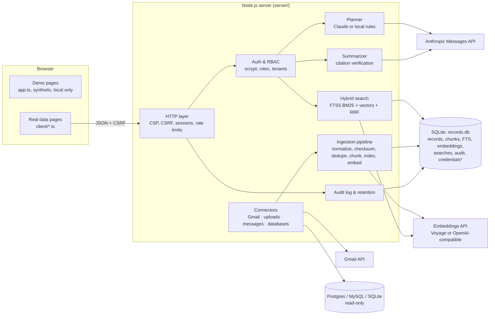

# Architecture

## Overview

\* Credentials are AES-256-GCM encrypted with a key held outside the database.

## Request flow

1. **Request**: staff type the request (Request & Plan, Real data mode).
2. **Plan**: `POST /api/searches/plan`. Claude receives the request (wrapped as untrusted data), the list of sources the user may search, the known departments, and today's date. It returns a plan that must match `PLAN_SCHEMA` (structured outputs). The server cleans the plan again: types, lengths, ISO dates, and only allowed source IDs. On any failure, the rule-based planner produces the plan and the reason is shown.
3. **Confirm**: staff edit the plan and must tick the confirmation. `POST /api/searches/:id/run` refuses an unconfirmed or empty plan.
4. **Retrieve**: `hybridSearch()` runs up to three ranked lists. Each SQL statement includes the access filter (tenant, source sharing, record ACL, Demo/Real separation) and the plan filters, so unauthorized rows are never read:
   - BM25 over primary terms (keywords, phrases, names, locations)
   - BM25 over alternate terms
   - cosine similarity over embeddings, when configured
5. **Rank**: reciprocal-rank fusion (k = 60; weights 1.0 / 0.6 / 0.8), plus small boosts for title, people, department and record type. Exclusions are applied. Each result is labeled *exact*, *related wording* or *similar meaning*, with reasons and a snippet.
6. **Group**: exact duplicates (same checksum), the same thread or conversation, and near-duplicates (4-word shingle Jaccard ≥ 0.85) share a `group_key`.
7. **Store and read**: results are stored per search. Every read joins the *viewer's* access filter again, so unsharing or disconnecting takes effect on old result lists.
8. **Summarize** (optional): Claude sees excerpts of the top K readable records inside `<record>` tags marked untrusted. Every citation must name a record that was sent and quote text that appears in it; otherwise it's removed. A finding with no surviving citation is dropped. The counts are shown to staff.
9. **Review**: staff mark each record Relevant, Not relevant or Unsure, with notes. These decisions drive the Evaluation page. Nothing is decided automatically.

## Ingestion

Every connector produces the same `NormalizedRecord` (`record_id, source_id, source_type, source_record_id, title, content, sender, recipients, created_at, modified_at, department, document_type, keywords, extracted_entities, access_permissions, source_url, checksum, ingestion_timestamp`, plus `parent_record_id` and `thread_key`). `upsertRecord()` then:

1. Computes a SHA-256 checksum. Unchanged records are skipped.
2. Marks exact duplicates within the tenant (`duplicate_of`).
3. Extracts keywords and entities (dates, emails, money, names) with rules.
4. Splits text into ~1,200-character chunks with 200 characters of overlap, keeping offsets back to the record.
5. Writes FTS5 rows. Chunks are embedded afterwards by `embedPending()`.

Deleting a record removes its chunks, full-text rows and embeddings. Gmail history deletions, database rows missing from a full sync, upload deletes and source disconnects all go through this path.

## Data model (migrations in `server/migrations/`)

`tenants · roles · users · sessions · sources · source_credentials · oauth_states · repositories · records · chunks · chunk_fts (FTS5) · embeddings · sync_jobs · search_requests · search_plans · search_results · search_summaries · evaluations · audit_events · ai_usage · settings`

Foreign keys cascade from tenant → source → record → chunk → embedding. Indexes cover tenant/date, checksum, thread and audit lookups.

## Security model

| Control | Implementation |
| --- | --- |
| Authentication | Email + scrypt (N=32768) passwords; 12-character minimum; lockout after 8 failures; timing-safe dummy hash for unknown emails. |
| Sessions | Random 256-bit token, stored hashed; HttpOnly, SameSite=Lax, Secure on https (`__Host-` prefix); 12-hour expiry; revoked on role change, disable or password reset. |
| CSRF | Per-session token required in `X-CSRF-Token` for every write, and the `Origin` must match. |
| Authorization | Role → permission map checked on every route. Records are filtered in SQL by tenant, source sharing (owner only or by role), per-record ACL and mode. Admins don't automatically see others' mailboxes. |
| Tenant isolation | `tenant_id` on every row and in every query; cross-tenant IDs return 404. |
| Secrets | API keys only in server environment variables. OAuth tokens and database passwords are AES-256-GCM encrypted; the key is outside the DB. Secrets are scrubbed from audit details. |
| Input | A declarative validator on every JSON body; body size limits; file type checked by magic bytes, not just extension; filenames sanitized; ZIP-bomb limits. |
| SQL | Only bound parameters internally. External databases: allowlisted, regex-checked, quoted identifiers; SELECT-only builder; read-only transaction; statement timeout. |
| Transport and browser | Strict CSP (`script-src 'self'`, no inline scripts or styles), `frame-ancestors 'none'`, no-referrer, nosniff. All client rendering uses `textContent`, never `innerHTML`. |
| Rate limits | Logins per IP+email; API requests per user/IP; planning and summaries per user. |
| Audit | Append-only events for sign-ins, searches, record views, exports, source access and sync, uploads, decisions, permission and settings changes, and blocked actions. IPs are stored as salted hashes; no record content or tokens. |
| Retention | Daily purge of old search history, audit events and AI usage (configurable); expired sessions and OAuth states removed. |
| Exports | CSV cells starting with `= + - @` are prefixed so spreadsheets don't run them as formulas. |

## Threat model (summary)

| Threat | Mitigations | Residual risk |
| --- | --- | --- |
| **Connector compromise** (stolen OAuth or database credentials) | Least-privilege scopes (`gmail.readonly`, read-only DB user); encrypted at rest with an external key; revoke on disconnect; tokens never logged or sent to the browser. | A server compromise exposes the key in memory. Use a secret manager and rotate on incident. |
| **Prompt injection in records** | Records go to Claude inside `<record>` tags flagged untrusted; the system prompt forbids following them; Claude has no tools and can't act; only allowlisted fields of the JSON output are used; citations are verified. | A malicious record can still skew a summary's wording. Summaries are labeled advisory and cite sources for checking. |
| **Data leakage** across users | Access filters inside the SQL of every query and every re-read; summaries only see records the requester can read. | Shared sources share all of their records; per-record ACLs exist but connectors set them only at source level today. |
| **Unauthorized export** | `export.create` permission; exports re-apply access filters; every export is audited. | A permitted user can still copy data out; that's what the audit log is for. |
| **Cross-tenant access** | `tenant_id` checks in every query; tests try to read across tenants. | Single database file; use separate deployments for strong isolation. |
| **Credential stuffing or brute force** | Rate limits, lockout, scrypt, uniform error messages. | No MFA yet; put the app behind SSO or a VPN for production. |
| **CSRF / XSS / clickjacking** | CSRF token + Origin check; CSP without inline scripts; DOM built with `textContent`; `frame-ancestors 'none'`. | None known. |

## Front end

- `app.ts` → `app.js`: the original synthetic demo engine, unchanged in behavior (checked by `smoke-test.js`). It stays idle when a page is in Real data mode.
- `client/api.ts` (fetch, CSRF, errors), `client/ui.ts` (safe DOM helpers, dialogs, toasts), `client/shell.ts` (navigation, Demo/Real switch, user menu, sign-in gate), and one module per page in `client/pages/`. Strict TypeScript, compiled to ES modules with no bundler or framework, matching the existing stack.
